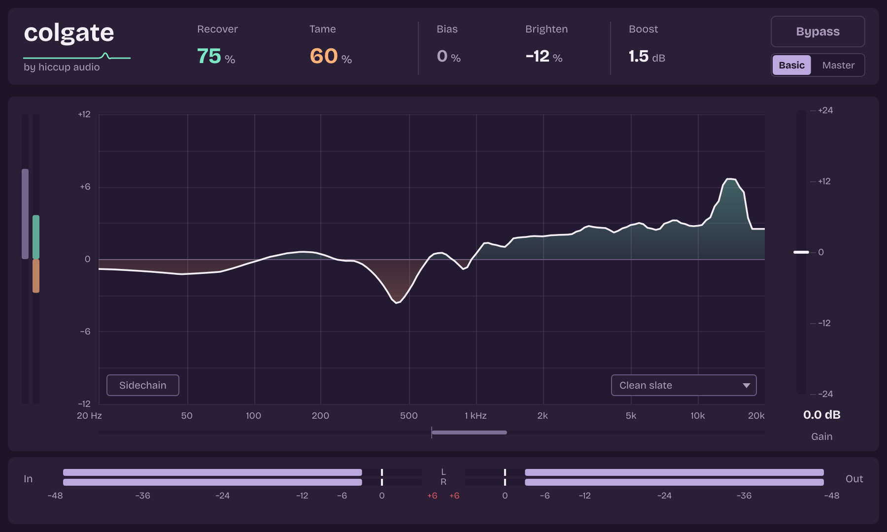

# Colgate

A perceptual equaliser by Hiccup Audio, for macOS (Audio Unit and VST3, Apple silicon and Intel).



Colgate is an EQ that adjusts itself hundreds of times a second. It looks at how each part of the spectrum sits against the rest, then makes the small moves that let more of it be heard, while keeping the overall level close to where it was.

It has two modes, **Basic** and **Master**, each tuned by measurement against renders through Gullfoss: four songs for Basic and six for Master. See [How close it is](#how-close-it-is).

## Get the installer

You don't need a Mac developer setup. GitHub builds the `.pkg` for you.

1. **Put this folder on GitHub.** The easiest way is [GitHub Desktop](https://desktop.github.com): choose *File > Add Local Repository*, pick this folder, accept the offer to create a repository, commit, then *Publish repository*. Leave "Keep this code private" unticked, since Mac builds are free for public repositories.

   Prefer the website? Create a new repository and choose *uploading an existing file*. Open this folder in Finder, press **Cmd+Shift+.** so the hidden `.github` folder shows, press **Cmd+A**, and drag everything into the page. Drag what's inside the folder, not the folder itself. The repository's main page should then list `.github` and `CMakeLists.txt` at the top.

   If the Actions tab shows no run, `.github/workflows/build.yml` isn't at the top of the repository, the only place GitHub looks. If the project went into a subfolder, moving just that file up is enough: the build finds the rest by itself, whatever the subfolder is called.

2. **Wait for the build.** Open the repository's **Actions** tab. A run called *Build macOS installer* starts by itself and takes about 15 to 25 minutes.

3. **Download.** Open **Releases** on the repository's main page and choose *Colgate (latest build)*. The file is `Colgate-1.4.0-macOS.pkg`. Each new push replaces it.

A red run in Actions doesn't always mean there's no installer. The installer is made first, and the tests and validators run afterwards. Open the run to see which check failed. The run's summary and the release notes list the results. The last step, *Report*, fails on purpose when an earlier check did, so look above it for the real error.

The build runs on GitHub's Intel Macs, because its Apple silicon ones are often unavailable. The installer works on both, but only the Intel half gets tested there. To test the other half, open *Actions > Build macOS installer > Run workflow* and tick the box. That run can wait a long time for a machine, and it can't affect the installer.

## Install it

Double-click the `.pkg`. If this repository has no Apple Developer ID set up (see below), macOS will refuse the first time, saying it can't verify the developer. Then:

1. Open **System Settings > Privacy & Security**.
2. Scroll down to the message about `Colgate-1.4.0-macOS.pkg` and click **Open Anyway**.
3. Finish the installer.

Plug-ins go to `/Library/Audio/Plug-Ins/Components` and `/Library/Audio/Plug-Ins/VST3`. Rescan in your host if Colgate doesn't appear. It's listed under Hiccup Audio.

## Using it

With everything at zero, Colgate passes audio through untouched. A good place to start is **15% Recover and 15% Tame on each bus**, or start from a preset in the menu at the bottom right of the graph.

| Control | What it does |
| --- | --- |
| **Recover** (0 to 200%) | Lifts what is covered up by other sounds, and dips the rest slightly to hold the balance. |
| **Tame** (0 to 200%) | Pulls down what is covering up other sounds, and lifts the rest slightly to hold the balance. |
| **Bias** (-100 to 100%) | Divides the range: up gives Recover more of it, down gives Tame more of it. |
| **Brighten** (-100 to 100%) | Uncover by favouring higher or lower frequencies. Needs Recover or Tame. |
| **Boost** (-50 to +50 dB) | The tonal balance you'd hear if the volume changed by this much, at the same loudness. Works by itself. Lowering it pushes a sound back in a mix without reverb. |
| **Gain** | Output level, for matching peaks or a key element. |
| **Bypass** | Compare with the dry sound, delay matched. **Shift-click** to bypass every Colgate in the session; the next click restores them. Instances of different formats (AU and VST3) don't affect each other. |
| **Basic / Master** | Basic is for tracks, buses and mixes. Master is for a finished stereo master: numbers show a decimal more, a drag moves them slower (Shift for faster), the EQ always updates at the Best rate, and it has its own tuning. Latency is the same. |
| **Sidechain** | Decide the EQ from the sidechain input. Feed each stem the full mix and the processed stems add up exactly to the processed mix. |

**On any number:** double-click to select it, then type the value you want and press Enter. Option-click returns it to its original value. You can also drag up and down, hold Shift for fine moves (coarse ones in Master), use the arrow keys when it's highlighted, or just start typing while it's highlighted. The scroll wheel works too, but moves made with it don't record as clean automation.

**On the graph:** drag to read frequency and gain at a point. Scroll, or drag or click the gain axis, to change the scale. Move the pointer to the left or right edge to reveal the range limiters and drag them in. Colgate leaves out what is beyond them, and if you cross them over, it leaves out the range between them instead. Double-click or Option-click a limiter to park it again.

**Reading the graph:** mint is lift, apricot is cut. If an area keeps getting a big lift, you can make that move in your mix directly. A big lift at the extremes often means there's little real content there, which is a good moment to use a limiter.

**Click the name** for window size, redraw rate, default scale and audio quality. Better and Best cost about 1.7 and 3.3 times the CPU of Normal, and Master always costs as much as Best. Changing quality or mode while playing briefly fades to the unprocessed signal, for about 30 ms.

**Worth trying:**

- Lead vocal: a touch of Recover and more Tame, limited to about 200 Hz to 5 kHz.
- Reverb return: Recover and Tame both high, and hear the tail settle in behind the mix.
- Master bus: go gently, less than you'd use on a vocal.

## How close it is

These compare Colgate with Gullfoss on the newest song, whose renders tried settings no earlier render had: amounts above 50%, Brighten -40, negative Boost and Boost alone. The scores come from the plug-in's actual audio. The figure is the share of how Gullfoss's gain moves, band by band and moment by moment, that Colgate reproduces (R²), where 1.0 would be identical.

| Setting | Mode | 1.3 | 1.4 |
| --- | --- | --- | --- |
| Recover 100, Bias 100 | Basic | 0.34 | 0.65 |
| Recover 100, Bias 100 | Master | 0.87 | 0.87 |
| Tame 100, Bias 50 | Basic | 0.79 | 0.77 |
| Recover 110, Tame 100, Bias 35 | Basic | 0.74 | 0.85 |
| Recover 110, Tame 100, Bias 35 | Master | 0.73 | 0.90 |
| The same with Brighten -40 | Basic | 0.04 | 0.78 |
| The same with Brighten -40 | Master | 0.10 | 0.79 |
| 17/15, Bias 34, Brighten -16, Boost -10 | Basic | 0.85 | 0.92 |
| 17/15, Bias 34, Brighten -16, Boost -10 | Master | 0.85 | 0.89 |
| Boost +25 alone | Basic | 0.96 | 0.96 |

Version 1.3 had never heard this song. The 1.4 figures use a tuning fitted without it, except for the five constants this song is the main source for, which come from its renders in the other mode. Up to 50% nothing changed from 1.3, where the same test on five songs gives 0.85 to 0.92, and 0.97 to 0.98 for Boost.

**What this doesn't cover.** High amounts rest on one song, and nothing above 110% was measured. Boost below -10, and Boost alone in Master, weren't measured either. At 15/15 Colgate moves less than Gullfoss does, on positive Boost its peaks run higher, by up to 3.5 dB, and nobody has compared the two by ear. [docs/DESIGN.md](docs/DESIGN.md) has the full tables and limits, and [tools/calibration](tools/calibration/README.md) can refit it from more renders.

## What's inside

- **Analyser:** a smoothed pseudo Wigner-Ville distribution, the time-frequency form of the phase-space picture from quantum mechanics, at three lag lengths that follow the ear's resolution.
- **Decision:** each band's level relative to the rest of the signal and its near neighbours, read through a separate curve for Recover and for Tame, with its own measured constants in Basic and Master.
- **Audio path:** one time-varying minimum-phase filter shared by both channels, with about 5 ms of latency at any sample rate from 44.1 kHz up.
- **Loudness:** one broadband gain, solved every moment, that keeps constant the same measure Gullfoss was found to keep constant, separately for Recover and Tame together and for Boost.

[docs/DESIGN.md](docs/DESIGN.md) covers what was measured, how the source material became code, and the limits.

## Build it yourself

You need Xcode's command line tools and CMake. JUCE is downloaded automatically.

```sh
cmake -S . -B build -DCMAKE_BUILD_TYPE=Release -DCMAKE_OSX_ARCHITECTURES="arm64;x86_64"
cmake --build build --parallel
ctest --test-dir build --output-on-failure
bash packaging/macos/build_pkg.sh build dist
```

## Signing, optional

Without an Apple Developer ID the plug-ins get an ad-hoc signature, which is enough for them to load, but the installer needs the *Open Anyway* step. To remove it, add these as repository secrets (*Settings > Secrets and variables > Actions*) and the build signs and notarizes by itself:

| Secret | Value |
| --- | --- |
| `APPLE_CERTIFICATES_P12` | Base64 of a `.p12` with your Developer ID Application and Installer certificates |
| `APPLE_CERTIFICATES_PASSWORD` | Its password |
| `APPLE_APP_IDENTITY` | For example `Developer ID Application: Your Name (TEAMID)` |
| `APPLE_INSTALLER_IDENTITY` | For example `Developer ID Installer: Your Name (TEAMID)` |
| `APPLE_NOTARY_ID` | Your Apple ID email |
| `APPLE_NOTARY_PASSWORD` | An app-specific password |
| `APPLE_TEAM_ID` | Your team ID |

## Licence and names

Colgate's own code is under the [GNU AGPL v3](LICENSE) because it builds on [JUCE](https://juce.com) under the same licence. If you share the plug-in, you share its source too. Selling it closed-source would need a commercial JUCE licence and a licence change.

- JUCE: AGPLv3. It includes the Steinberg VST3 SDK, MIT licence.
- [Bricolage Grotesque](https://github.com/ateliertriay/bricolage) typeface: SIL Open Font License ([assets/OFL.txt](source/plugin/assets/OFL.txt)), subset for the UI.

This is an independent implementation written from public descriptions and published mathematics, then tuned by measuring how renders through Gullfoss differ from the dry signal. It contains no third-party plug-in code and isn't affiliated with or endorsed by Soundtheory. Gullfoss is theirs. Before publishing, check that its licence allows measuring its output for this purpose, and keep the reference audio out of this repository. Colgate is a registered trademark of Colgate-Palmolive, which is worth settling before releasing this publicly under that name. Whether US 2005/0065781 or any related patent is in force wasn't checked, so get legal advice before selling it.

VST is a registered trademark of Steinberg Media Technologies GmbH. Audio Units is a trademark of Apple Inc.
